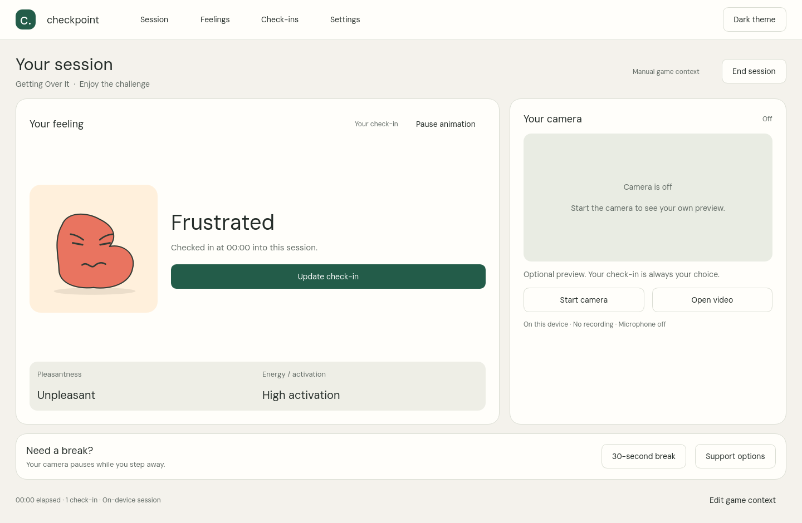
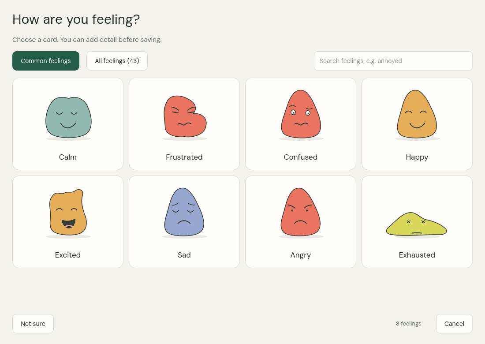

# Checkpoint — native Windows gaming companion

A native desktop app for checking in with your feelings during a game. Choose from 43 illustrated cards, adjust pleasantness and energy independently, and take a break when you want one.

## Download for Windows

**[Download Checkpoint for Windows x64](https://github.com/AnujR17/Chatgpt-Environment/releases/download/checkpoint-v0.1.0-preview.1/Checkpoint-Windows-Preview.zip)** · [Release and checksums](https://github.com/AnujR17/Chatgpt-Environment/releases/tag/checkpoint-v0.1.0-preview.1)

1. Download `Checkpoint-Windows-Preview.zip` and **extract the entire archive**.
2. Open the `Checkpoint-Windows` folder.
3. Double-click **Start Checkpoint.cmd**. Python and Qt are included.

Windows 10/11 x64 is the target. Keep the extracted folders together. Run **Check setup.cmd** for diagnostics. This is an unsigned research preview. The downloadable package was assembled and verified in Linux; native Windows execution has not been checked here.



## What works

- Eight common feeling cards first; all 43 available through search and the full library.
- Check-ins with independent pleasantness and energy sliders; cancellation preserves your last report.
- Optional preview of your own camera or a local video, with camera off initially.
- Breaks, session completion, light/dark appearance, reduced animation and optional local summary history.



Feelings and CMA come from **your check-in**. Facial-expression inference is experimental, disabled by default and cannot assign your mood or trigger interventions. Microphone and gameplay capture are not implemented. Normal use does not record or upload video. History is off by default.

## Source and verification

```sh
cd topics/checkpoint/app
python -m venv .venv
# Windows PowerShell:
.venv\Scripts\Activate.ps1
python -m pip install -r requirements-runtime.txt
python -m pip install --no-deps -e .
python -m checkpoint.app
```

27 automated checks passed in the original Linux workspace. Windows launch remains a target-device check. Physical-camera access, player recognition of the illustrations and performance on your computer remain unverified. The model failed its production release gates; this is a research preview.

[Windows instructions](docs/WINDOWS-APP.md) · [Feature applicability](docs/FEATURE-APPLICABILITY.md) · [Model card](artifacts/MODEL-CARD.md) · [Third-party notices](third_party/NOTICES.md) · [Editable Figma](https://www.figma.com/design/Rj3WAO6IpUb48OFUerY7aW?node-id=108-127)

To run software checks, install pytest and run `python -m pytest -q`. The external-video test requires the separately sourced research fixture and skips when it is absent. Raw training images, evaluation videos, downloaded visual references, caches and environments are excluded from this repository.

The exact Python embedded runtime and wheel hashes are recorded in `design/windows-runtime-sources.json`. The scripts in `scripts/` assemble and verify a portable Windows bundle from the vendor files under `build/`. They do not train or alter the model. SHA256SUMS.txt in the release verifies the downloadable ZIP.
