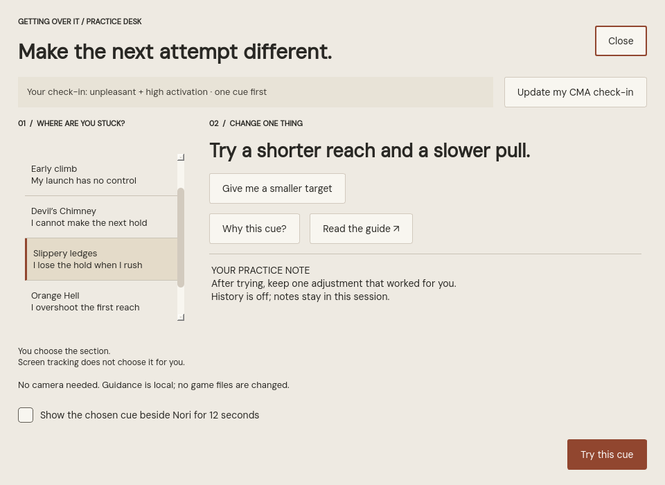

# Checkpoint · Session study

New branch: **topic/checkpoint-session-20261116**, based on the existing Windows build. The stable branch and OTA channel remain unchanged.

This branch adds **Next attempt**: choose the Getting Over It problem you are stuck on, get one practical cue, try it, and mark **Helped / Still stuck**. Keep your own useful adjustment for later. Recent player-reported CMA changes the amount of guidance; it does not invent an emotion from the camera.

[Research, rationale and working flow](docs/NEXT-ATTEMPT.md) · [Windows review workflow](https://github.com/AnujR17/Chatgpt-Environment/actions/workflows/checkpoint-session-review.yml)

Download **checkpoint-session-study** from the latest successful run for this branch. Extract it, then extract **Checkpoint-Session-Study.zip** into a separate folder and run **Start Checkpoint.cmd**. This is a review artifact; it does not update your stable installation or OTA channel. GitHub Actions downloads require a GitHub login and expire after 14 days.

Open **Next attempt** on the session screen or tray. Optional cue text appears beside Nori for 12 seconds; the paired phone shows the same chosen cue. **Review attempt** records your verdict and an optional note. Notes survive a new session only when saved summaries are enabled in Settings and the session is saved. The PDF includes actual cue feedback alongside your CMA check-ins.

Camera recognition and automatic game-scene limitations remain. These source-linked prompts and CMA presentation rules are a working prototype, not validated coaching or proof of frustration reduction.

[Native flow verification](docs/PRACTICE-VERIFICATION.json) · [Native-to-phone browser verification](docs/PRACTICE-PHONE-VERIFICATION.json)

## Development and evidence

Source uses native PySide6/OpenCV/ONNXRuntime/MediaPipe, without a desktop browser engine. Runtime wheels and hashes are pinned in design/windows-runtime-sources.json. Create a venv, install requirements-runtime.txt and install this project with `python -m pip install --no-deps -e .`; run `python -m checkpoint.app`. Tests use pytest; separately sourced research videos and the provider hand example are not committed. Linux development can require system EGL/GLES libraries.

Model provenance, notices, software tests and browser checks are under artifacts/ and third_party/. [Release verification](../RELEASE-VERIFICATION.json) records downloaded package checks and native Windows fixtures. Rendered previews use labelled synthetic signals. The earlier eight-class comparison (62.5% vs 29.8% on 208 acted clips) does not establish personal webcam or 43-emotion accuracy. [Research](docs/VIDEO-AND-MODEL-RESEARCH.md) · [Model card](artifacts/MODEL-CARD.md).
