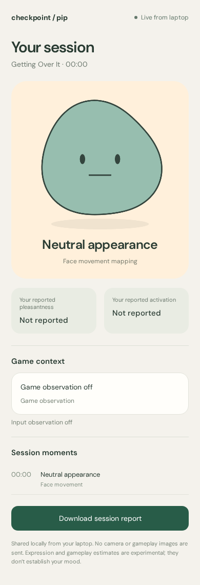
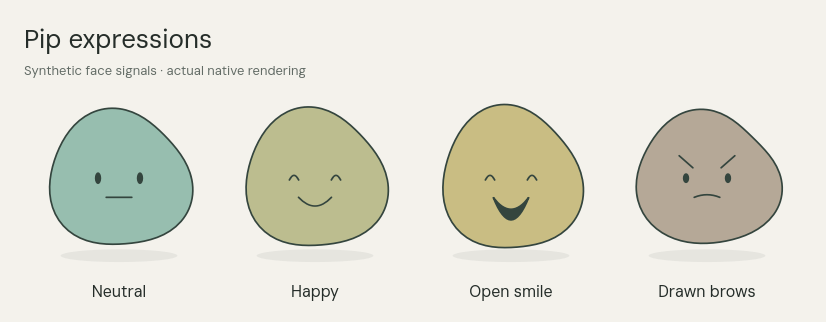

# Checkpoint with Pip

Pip is an original soft desktop companion. The Windows app maps visible face movements locally, observes optional Getting Over It context and input timing, and shares a small phone dashboard. One body morphs smoothly; neutral and missing detection use a flat neutral face.

## Download and use

**[Download the Windows portable app](https://github.com/AnujR17/Chatgpt-Environment/releases/download/checkpoint-v0.3.0-preview.1/Checkpoint-Windows-Preview.zip)** · [Release](https://github.com/AnujR17/Chatgpt-Environment/releases/tag/checkpoint-v0.3.0-preview.1)

Already using the working **0.2.1 camera-fix build**? [Download the small app patch](https://github.com/AnujR17/Chatgpt-Environment/releases/download/checkpoint-v0.3.0-preview.1/Checkpoint-App-Update.zip) (256 KB). Close all Checkpoint/Check setup windows, extract it and copy its contents into your existing **Checkpoint-Windows** folder, replacing files. Then restart. This patch reuses 0.2.1’s identical runtime/models; use the full download for a fresh installation or an older version. Future updates use the in-app button.

Extract the whole ZIP into a new folder, run **Start Checkpoint.cmd**, tick **Track my face**, then **Start camera**. Click **Show Pip** for the frameless click-through companion. **Phone dashboard** displays a pairing QR: scan it from a phone on the same trusted Wi-Fi. No phone-store installation is required; the phone view is a local browser dashboard.

[Controls and pairing](docs/PIP-COMPANION.md) · [Windows instructions](docs/WINDOWS-APP.md) · [Video shortlist and training](docs/VIDEO-AND-MODEL-RESEARCH.md) · [Model comparison](artifacts/pretrained-comparison.json)



## Updates and expressions

Install this version once to get **Settings → Check for updates**. Future releases offer **Update and restart** inside the app, with a small app payload when the runtime/models can be reused and a full-package fallback otherwise. Downloads are checked before staging; failed startup restores the previous installation. No silent update is installed. [How updates work](docs/IN-APP-UPDATES.md).

Pip now responds to smaller smiles, open smiles and drawn brows with a faster continuous transition. Neutral stays flat. An open smile gets soft happy eyes, an open mouth and a tiny bob; inward brows give a firmer expression. These are physical-movement mappings, not new emotion-model classes or measured moods. [Motion behaviour](docs/EXPRESSIVE-PIP.md).



## What is implemented

- Local Google MediaPipe physical-face mapping, optional in-memory neutral calibration and movement strength. No posed personal emotion-photo set is needed.
- Alternative provider-trained HSEmotion expression estimates: 62.5% versus 29.8% for the earlier classifier on the matched 208 acted-video clips. This does not establish personal webcam or gamer-mood accuracy.
- Transparent, frameless, no-focus desktop Pip; click-through during play, corners/temporary drag mode configured from the main app. Exclusive fullscreen and game-specific compatibility remain target-device checks.
- Token-paired, read-only local phone dashboard with live state, game context, source-labelled recent moments and JSON report download. No face/game images, typed text or key identities are exported. Local HTTP is intended for a trusted private network.
- Optional supported-foreground-game detection, Getting Over It window observation, aggregate mouse/key timing and conservative quiet nudges. Current game events are experimental heuristics; no full-map or frustration detector is claimed.
- Separate player check-ins/CMA, 43 selectable words, light/dark native UI, reduced motion, optional check-in retention, breaks and clean capture shutdown.

The source list contains six YouTube candidates and an accessible publisher trailer. YouTube downloads were denied by the workspace proxy. An actual small scene model was trained on inspected trailer frames and evaluated, but it confused an opening view and stays out of live cue decisions. See the research report for exact splits and limitations.

## Verify and reproduce

Source targets Python 3.13 and the pinned native Windows wheels. From the repository root:

```sh
cd topics/checkpoint/app
python -m venv .venv
.venv\Scripts\Activate.ps1
python -m pip install -r requirements-runtime.txt
python -m pip install --no-deps -e .
python -m checkpoint.app
```

Run `python -m pytest -q` after installing pytest. Separately sourced face-video fixtures are not committed and their tests skip when absent. The face mapper can require system EGL/GLES libraries for a Linux development environment; those are not Windows installation requirements. Windows runtime wheels and hashes are in design/windows-runtime-sources.json. The branch workflow assembles and verifies the portable release; raw datasets, footage, caches and vendor downloads are excluded from Git.

Browser-to-native phone verification uses Chromium at a 390×844 viewport and synthetic cues, not a physical phone or recognition-accuracy test. Actual recorded-video mapping, model benchmarking and software tests have separate evidence. Check [release verification](../RELEASE-VERIFICATION.json) and artifacts for the publication results. No game-FPS, battery, camera-hardware or intervention-effectiveness claim is inferred from software checks.

[Model card](artifacts/MODEL-CARD.md) · [Third-party notices](third_party/NOTICES.md) · [Older editable Figma card design](https://www.figma.com/design/Rj3WAO6IpUb48OFUerY7aW?node-id=108-127)

Camera will not start, or the phone QR link will not load? See [camera and phone troubleshooting](docs/CAMERA-AND-PHONE-TROUBLESHOOTING.md). The updated build tries DirectShow first and lets you choose another camera. The pairing dialog includes adapter names, a laptop link test and an explicit Windows Private-network firewall helper.
