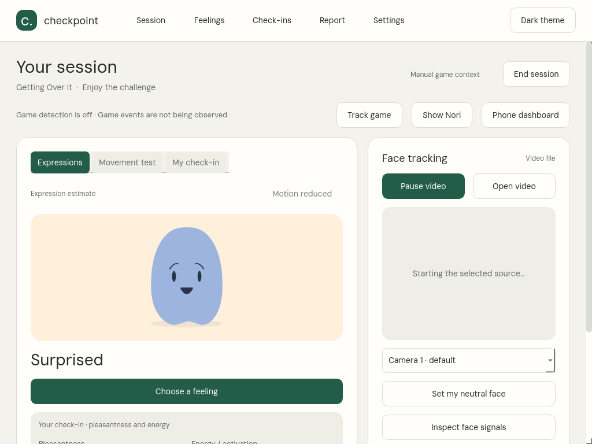
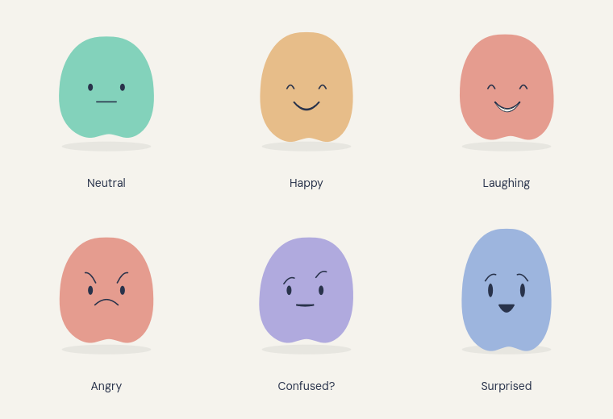

# Checkpoint with Nori

Nori is a local Windows gaming companion. **Expressions** shows short facial-expression estimates with a soft character, curved brows and smooth colour/shape changes. **Confused?** is a tentative multi-feature cue; it is not a newly trained class. **Movement test** inspects the tracker; **My check-in** records your own feeling and CMA. [Expression and game-state research](docs/EXPRESSIONS-AND-GAME-STATE.md).

**Stuck returning to 0.4 after an update?** Use the [small one-time updater repair](https://github.com/AnujR17/Chatgpt-Environment/releases/download/checkpoint-v0.6.1-preview.1/Checkpoint-Updater-Repair.zip). It reuses your existing runtime; [instructions](docs/IN-APP-UPDATES.md#061-rollback-to-04-after-a-sharing-violation).

Already on 0.3? Use **Settings → Check for updates → Update and restart**. The compatible app package includes the new hand model without replacing the native runtime. **[Full Windows download](https://github.com/AnujR17/Chatgpt-Environment/releases/download/checkpoint-v0.6.1-preview.1/Checkpoint-Windows-Preview.zip)** · [Release](https://github.com/AnujR17/Chatgpt-Environment/releases/tag/checkpoint-v0.6.1-preview.1)

For a fresh install, extract the full ZIP and run **Start Checkpoint.cmd**. Choose **Start face tracking** to enable local analysis and open the camera in one action. Use **Track game** to enable Getting Over It window vision in one action. **Mark section** remembers a named view in RAM so it can recognise a return. Climb/fall states are background-motion estimates, not confirmed game events. Clean sustained signals changed poses in 0.5–0.9 seconds in deterministic replay; actual camera latency and recognition vary. **Open video** tests a local clip. **Show Nori** enables the frameless companion. Hold **Ctrl+Alt and drag**, then release to lock its position. **Phone dashboard** pairs on the same trusted private Wi-Fi.

[Reflection, face mapping, CMA and dragging](docs/NORI-REFLECTION-AND-CMA.md) · [Updates](docs/IN-APP-UPDATES.md) · [Camera/phone troubleshooting](docs/CAMERA-AND-PHONE-TROUBLESHOOTING.md) · [Video testing](docs/VIDEO-EXPRESSION-TESTING.md)

All 43 feeling words have selectable character profiles. They are not 43 trained camera classes. The default tracker uses eight-class HSEmotion estimates with face/hand quality and contradiction checks. It distinguishes mouth widening from smiling and withholds hidden mouth cues under possible hand occlusion. Visible teeth use a conservative image heuristic. These features need target-person checking; model scores cannot establish felt emotion or either CMA axis.

**Report** shows a CMA journey, check-in summaries, sample region counts and a next-session reflection. Both desktop and phone download a readable PDF. No facial event log or raw input timeline is presented. [Example report with synthetic check-ins](artifacts/nori-cma-preview.pdf).

Getting Over It screen tracking, local named-view matching and input-timing nudges remain experimental. Game-event accuracy, anti-cheat/fullscreen compatibility, device FPS/power and intervention helpfulness have not been established. Camera, models, frame processing and reports stay on the laptop. Phone sharing is token-paired local HTTP for a trusted private LAN; no raw camera/game images or typed text are exported.

## Development and evidence

Source uses native PySide6/OpenCV/ONNXRuntime/MediaPipe, without a desktop browser engine. Runtime wheels and hashes are pinned in design/windows-runtime-sources.json. Create a venv, install requirements-runtime.txt and install this project with `python -m pip install --no-deps -e .`; run `python -m checkpoint.app`. Tests use pytest; separately sourced research videos and the provider hand example are not committed. Linux development can require system EGL/GLES libraries.

Model provenance, notices, software tests and browser checks are under artifacts/ and third_party/. [Release verification](../RELEASE-VERIFICATION.json) records downloaded package checks and native Windows fixtures. Rendered previews use labelled synthetic signals. The earlier eight-class comparison (62.5% vs 29.8% on 208 acted clips) does not establish personal webcam or 43-emotion accuracy. [Research](docs/VIDEO-AND-MODEL-RESEARCH.md) · [Model card](artifacts/MODEL-CARD.md).
