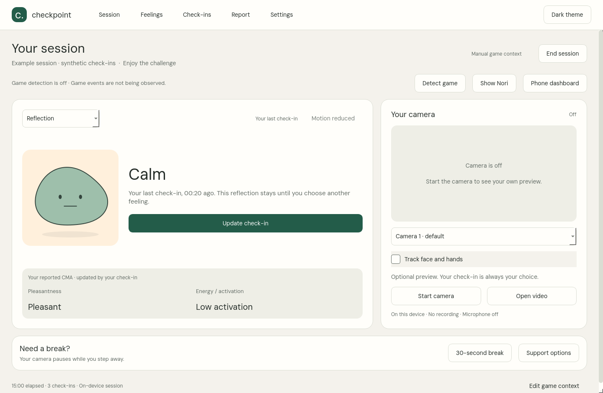

# Checkpoint with Nori

Nori is a local Windows gaming companion. Its default **Reflection** view considers sustained visual patterns and your own check-ins. **Face preview** is an instant tester for facial and hand movements. CMA reports describe your reported pleasantness and activation; they do not invent a mood history from a webcam.

Already on 0.3? Use **Settings → Check for updates → Update and restart**. The compatible app package includes the new hand model without replacing the native runtime. **[Full Windows download](https://github.com/AnujR17/Chatgpt-Environment/releases/download/checkpoint-v0.4.0-preview.1/Checkpoint-Windows-Preview.zip)** · [Release](https://github.com/AnujR17/Chatgpt-Environment/releases/tag/checkpoint-v0.4.0-preview.1)

For a fresh install, extract the full ZIP and run **Start Checkpoint.cmd**. Start your camera and optionally enable **Track face and hands**. Reflection uses a 20-second observation window and stable display holds; your confirmed check-in stays in charge. Choose **Face preview** for immediate movement tests, or **Open video** to test a local clip. **Show Nori** enables the frameless companion. Hold **Ctrl+Alt and drag**, then release to lock its position. **Phone dashboard** pairs on the same trusted private Wi-Fi.

[Reflection, face mapping, CMA and dragging](docs/NORI-REFLECTION-AND-CMA.md) · [Updates](docs/IN-APP-UPDATES.md) · [Camera/phone troubleshooting](docs/CAMERA-AND-PHONE-TROUBLESHOOTING.md) · [Video testing](docs/VIDEO-EXPRESSION-TESTING.md)

All 43 feeling words have selectable character profiles. They are not 43 trained camera classes. The default tracker combines physical face/hand cues with separate eight-class HSEmotion scores. It distinguishes mouth widening from smiling and withholds hidden mouth cues under possible hand occlusion. Visible teeth use a conservative image heuristic. These features need target-person checking; model scores cannot establish felt emotion or either CMA axis.

**Report** shows a CMA journey, check-in summaries, sample region counts and a next-session reflection. Both desktop and phone download a readable PDF. No facial event log or raw input timeline is presented. [Example report with synthetic check-ins](artifacts/nori-cma-preview.pdf).

The optional Getting Over It visual cues and input-timing nudges remain experimental. Game-event accuracy, anti-cheat/fullscreen compatibility, device FPS/power and intervention helpfulness have not been established. Camera, models, frame processing and reports stay on the laptop. Phone sharing is token-paired local HTTP for a trusted private LAN; no raw camera/game images or typed text are exported.

## Development and evidence

Source uses native PySide6/OpenCV/ONNXRuntime/MediaPipe, without a desktop browser engine. Runtime wheels and hashes are pinned in design/windows-runtime-sources.json. Create a venv, install requirements-runtime.txt and install this project with `python -m pip install --no-deps -e .`; run `python -m checkpoint.app`. Tests use pytest; separately sourced research videos and the provider hand example are not committed. Linux development can require system EGL/GLES libraries.

Model provenance, notices, software tests and browser checks are under artifacts/ and third_party/. [Release verification](../RELEASE-VERIFICATION.json) records downloaded package checks and native Windows fixtures. Rendered previews use labelled synthetic signals. The earlier eight-class comparison (62.5% vs 29.8% on 208 acted clips) does not establish personal webcam or 43-emotion accuracy. [Research](docs/VIDEO-AND-MODEL-RESEARCH.md) · [Model card](artifacts/MODEL-CARD.md).
