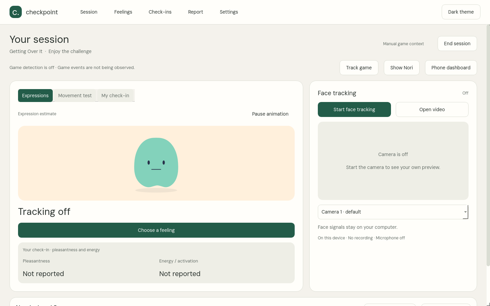
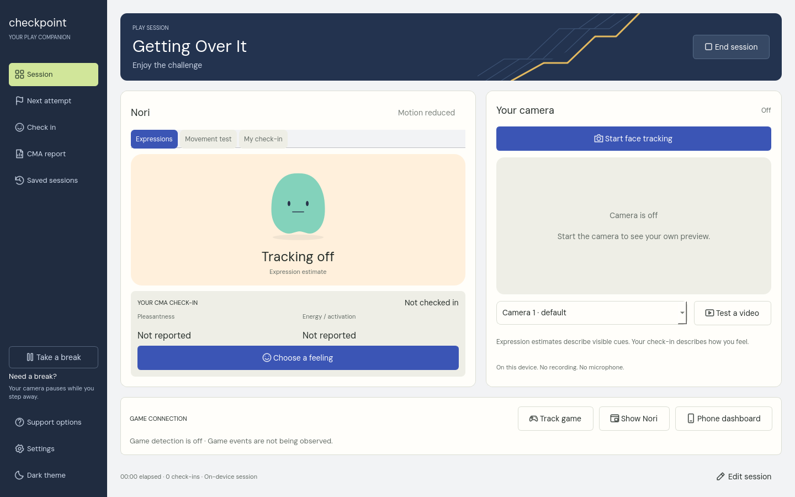
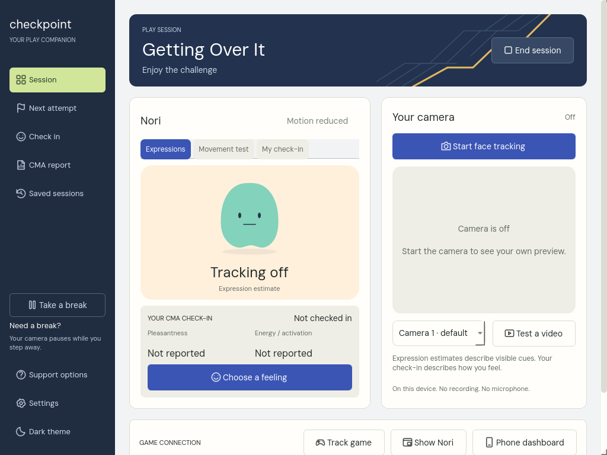
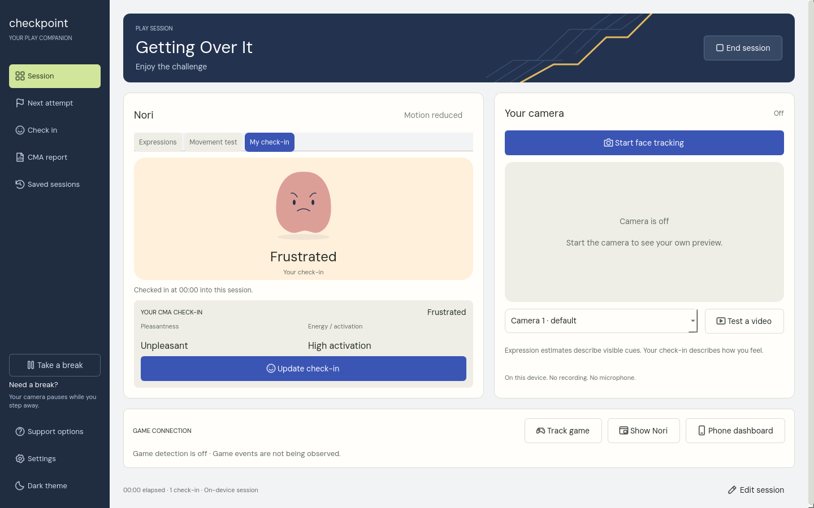
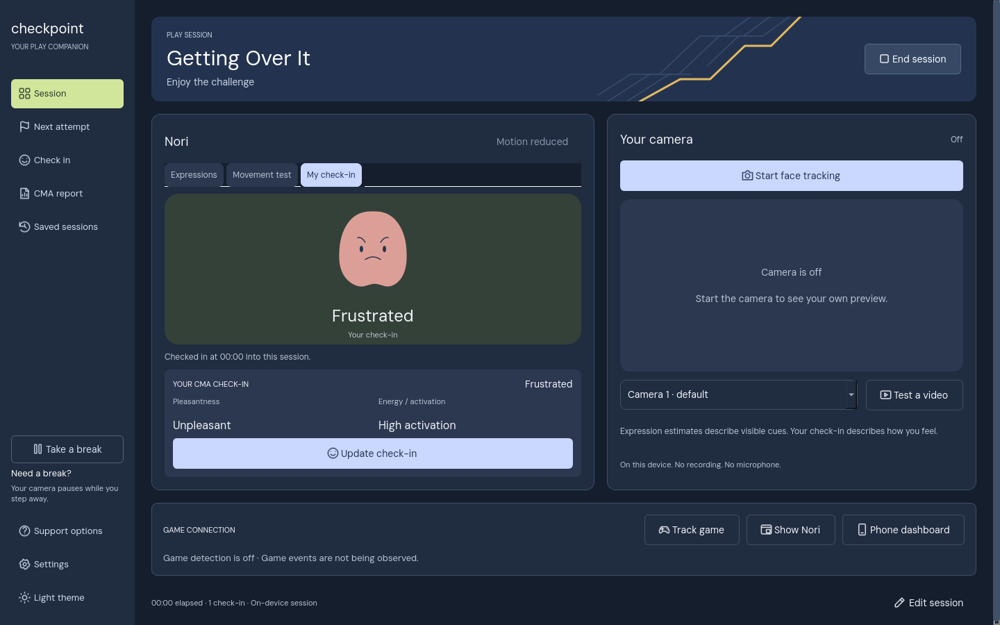
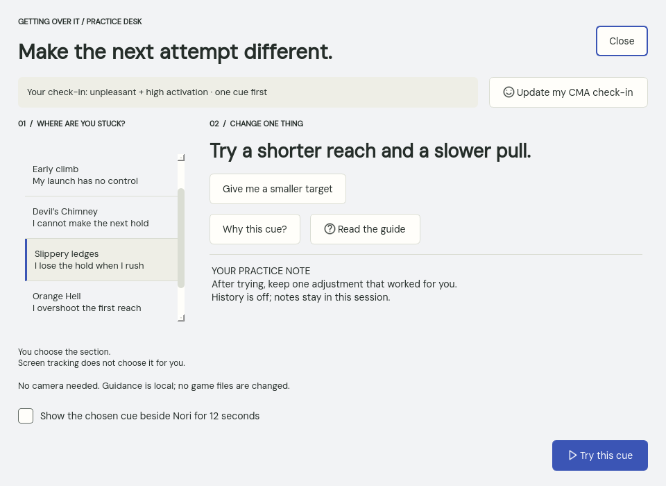
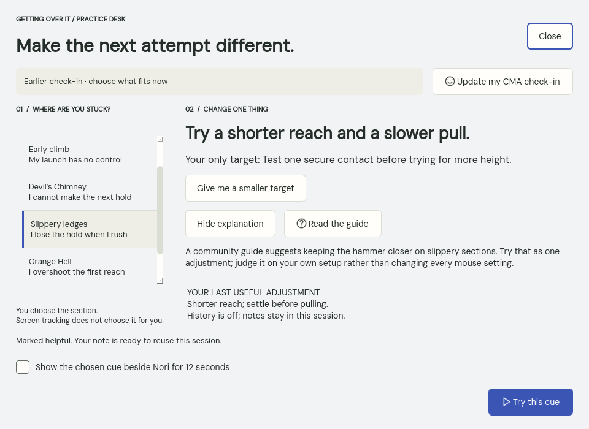
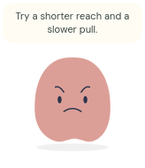
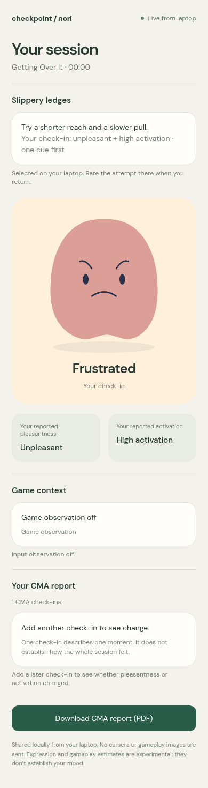

# Checkpoint

## A useful next attempt, on the player’s terms

Interaction design and local service prototype. Windows desktop, frameless companion and paired phone. Design review, 18 November 2026.

**The problem:** a player can still want the challenge while feeling stuck. An expression animation alone offers little help with what to do next.

**The proposal:** use a player’s own CMA check-in to adjust the amount of optional practice help. Offer one chosen cue, let the player try it, then keep the adjustment they say was useful.

**Status:** implemented review prototype. Software flows verified. Usefulness during real play is untested. This revision changes the interface and integrates an existing practice prototype; it does not retrain emotion models or publish an OTA release.

[Classroom brief mapping](BRIEF-MAPPING.md) · [Presentation and layout plan](index.html) · [Feasibility discussion](FEASIBILITY.md) · [Research evidence register](../../../research/04-evidence-register.md)

## 1. Classroom brief first

**Project type:** Individual Design Project. **Subject:** Human Computer Interaction Design. **Theme:** AI for Society / Social Cause. **Framework:** Circumplex Model of Affect (CMA).

**Technology:** personal-device cameras and sensors. In this prototype that means the laptop webcam, optional game-window capture and aggregate input timing; the phone is a display. **Tools used:** Codex-assisted research, coding and writing; existing MediaPipe/HSE inference; Python, PySide6 and QPainter for the app and original vector UI; Playwright/Chromium, Git and GitHub for verification and delivery.

**Core concepts:** design an interaction using AI/computer input through a system, service and product, with an intended human benefit. The product is the native companion; the service is choosing, trying and reflecting on a useful next attempt. Agency during difficult play is the intended benefit, not an established wellbeing result.

**Design process:** Empathize, Define, Ideate, Prototype. The [brief mapping](BRIEF-MAPPING.md) traces every requirement and stage to a concrete artifact and an evidence limit. AI assistance is documented alongside the tools and evidence.

### Empathize

Use the existing secondary evidence and five clearly fictional persona scenarios to identify uncertainties. No primary interviews have been completed.

### Define

Frame the job as: “When I keep missing a difficult section but still want the challenge, help me choose one adjustment without taking over my play.” Start with casual and committed hobby players.

### Ideate

Compare the companion, launcher, venue service and automatic emotional coach. Choose the companion boundary; specify task navigation and a layout plan before reviewing the final screens. The plan in this document describes this revision; it was not an earlier user-tested artifact.

### Prototype

Implement the native session, CMA check-in, chosen cue, feedback, consented note recall and report. Verify software behaviour; leave real-play validation visibly outstanding.

## Keep the brief, sharpen the benefit

CMA remains central. Sense, Infer, Decide, Respond, Learn is an explanatory implementation loop, not the wording of the classroom board. The working use case is an individual playing Getting Over It on Windows, practising a difficult section without wanting a full walkthrough or an interruption after every setback.

The initial audience is casual and committed hobby players who value learning a difficult game. Professional coaching, esports performance improvement and clinical emotion regulation require evidence this prototype does not have. Indian contexts matter for recruitment and evaluation, especially shared spaces, ordinary laptop hardware and camera comfort. They do not justify a separate inferred “Indian emotion” model.

The player should have a concrete reason to open Checkpoint: find one adjustment to try, get back to the game and remember what worked. The CMA journey adds context to that decision. The character makes the companion recognisable; expression imitation alone is not the value proposition.

## 2. What the research supports

| Evidence | Design implication | Limit |
| --- | --- | --- |
| Cregan, Toth and Campbell’s 2024 survey of 1,007 gamers associates competitive motives with tilt risk and adaptive regulation with lower risk. | Make support voluntary and let players choose a response. | Association does not establish causes or prove this product helps. |
| Getting Over It’s own description explicitly centres difficult climbing and repeated progress loss. | Single-player setbacks are a valid context for the prototype. | Online play is not the only context for frustration. |
| Russell’s circumplex describes affect along pleasantness and activation. | Use both dimensions to shape an interaction, rather than treating high energy as bad. | CMA is not a list of 43 universally detectable emotions. |
| Barrett and colleagues’ review challenges a universal, reliable mapping from facial movement to felt emotion. | Keep camera estimates separate from player reports. | A furrowed brow cannot establish anger, confusion or either CMA coordinate. |

The earlier research pack uses a purposive secondary review and five fictional persona rehearsals. No real participant was interviewed. No streamer clip was systematically coded. No preference, success rate or quotation below is presented as primary evidence.

### Five scenarios to test, not five research participants

| Fictional composite | Scenario | Assumption to test |
| --- | --- | --- |
| Rohan, Indian competitive player | A setback and teammate conflict compete for attention. | A quiet, optional response is preferable to repeated warnings. |
| Kavya, Indian multilingual competitor | Camera interpretation and social context may disagree. | Correction, source labels and privacy controls are understandable. |
| Aman, Indian player with limited time | A short session should produce one useful lesson. | A small practice target is worth the effort of opening another app. |
| Alex, challenge-oriented player | Struggle is part of the attraction. | Partial cues preserve satisfaction better than a full solution. |
| Morgan, player and streamer | Performance for an audience can resemble genuine distress. | Player control over sharing and labels is essential. |

These are condensed design scenarios from the existing simulated interviews. Their anticipated answers are hypotheses. The original [interview guide](../../../research/02-interview-guide.md) and [simulated answers](../../../research/03-simulated-interviews.md) remain clearly separated.

## 3. The CMA interaction

A player chooses a feeling word and adjusts pleasantness and activation. The 43 words are an authored check-in vocabulary, not 43 camera classes. The suggested coordinates are adjustable anchors, not validated measurements of every person’s feeling.

| Current player report | Default help | Player control |
| --- | --- | --- |
| Unpleasant and highly activated | One short cue first; explanation collapsed. | Open the explanation or request a smaller target. |
| Unpleasant and low activation | One smaller, achievable practice target. | Choose another problem or decline help. |
| Other, mixed, missing or older than five minutes | Choose the amount of help. | No inferred replacement from the camera. |

Prototype thresholds are pleasantness below −0.18, activation above +0.4 or below −0.4, and report age at most 300 seconds. These are authored interaction parameters to test, not rules prescribed by CMA. A selected cue remains stable during the attempt; a new facial movement or check-in does not make it flicker.

| Framework stage | Implemented role |
| --- | --- |
| Sense | Optional local face and hand tracking, optional supported game-window observation, and explicit player check-ins. |
| Infer | Estimate visible expression and limited game motion separately. Use the recent player report as the basis for CMA. |
| Decide | Player selects the problem. A transparent rule suggests brief, smaller or expanded guidance. |
| Respond | Show one cue on demand. Optionally pin it beside Nori for 12 seconds or read it on the paired phone. |
| Learn | Ask Helped or Still stuck. Reuse an explicitly helpful note when local history is enabled. No automatic model learning occurs. |

## 4. Navigation and layout

The previous screen gave source tabs, large character art, diagnostics and session actions similar visual weight. At a compact viewport the check-in values fell below the initial view. “Check-ins” also led to saved history, blurring an action with a destination.

The revised information architecture uses stable task names:

```
Session
  Expression or last check-in representation
  Own-camera controls and preview
  CMA check-in
  Game connection, desktop companion and phone pairing
Next attempt
  Select problem, choose cue, try, rate, optional note
Check in
  Feeling library, adjustable CMA values, save or cancel
CMA report
  Reported journey, practice feedback, PDF
Saved sessions
  Consented local summaries and deletion
Settings
  Display, sensing, retention and existing updater
```

The presentation includes a layout plan for this revision. It is a reconstructed specification of the implemented layout, not a claim that an earlier wireframe was tested with users.

## 5. A gaming identity with readable controls

The user’s feedback was specific: the interface lacked gaming energy and relied too heavily on boxes and text. The revision uses an ink navigation rail, lime selection state, cobalt actions and an original climbing motif in the session header. Line icons accompany navigation and camera, game, phone, overlay and check-in actions. Text labels remain for clarity.

Light mode stays available as the default; dark mode uses the same hierarchy. Nori retains soft features, smooth movement and a genuinely flat neutral mouth. The session still shows the player’s own camera rather than a redundant gameplay feed. Source labels distinguish an estimated expression from a self-reported feeling.

Before this revision:



Revised native interface:









The images are actual Qt captures. The check-in and practice examples are scripted demonstration states, not observations of a real participant.

## 6. The working player flow

1. Start a session with camera and game observation off.
2. Check in if useful. Choose a feeling and adjust both CMA dimensions.
3. Open Next attempt and select a Getting Over It practice problem.
4. Read one cue. Open the explanation or request a smaller target when wanted.
5. Choose Try this cue. Optionally display it beside Nori or on the paired phone.
6. Return and choose Helped or Still stuck. Write an optional adjustment worth repeating.
7. Open the CMA report or end the session. History stores summaries only with consent.





The five practice prompts are original short formulations informed by linked public guides. Sections are selected manually. Existing screen recognition can recognise marked views in memory; it does not automatically select these cues or understand the whole route.





The phone receives derived state from the laptop over a token-paired local HTTP connection. It does not run recognition, use its own camera, or receive face/game images. It hides an active cue when resolved or disconnected. Private Wi-Fi, firewall configuration and the laptop remaining open still matter.

## 7. Verification and honest limits

The local regression suite passed 113 checks, with four missing-video fixtures and one Windows-only check skipped. Native task checks exercised both 1440×900 and 1024×768 layouts, cue selection, smaller-target override, stable in-flight guidance, feedback, consented cross-session recall, break state and PDF generation.

A real native HTTP bridge and Chromium phone viewport verified selected-cue delivery, removal after feedback, hiding after disconnection, PDF download and no horizontal overflow. No JavaScript errors were reported. [Native verification](verification.json) and [browser verification](phone-verification.json) identify their scripted inputs.

A separate read-only Windows CI workflow exercises native models and a GDI capture fixture. Its final result is recorded in [feasibility and verification](FEASIBILITY.md). No physical webcam, actual Getting Over It session, phone Wi-Fi, target-device frame-rate effect or participant benefit was tested in this review.

The existing model comparison reports 62.5% eight-class accuracy on 208 acted RAVDESS clips. That is a different task and population from Indian gamers during play. It is not Checkpoint’s in-game mood accuracy and this UI revision does not improve that number.

## 8. Feasibility and the next decision

**Recommended boundary:** a local, player-controlled Getting Over It practice companion, with CMA-adjusted help and a useful session takeaway. Sensors enrich optional context. They do not supply emotional truth.

A launcher, a venue service and a camera-led “43-emotion detector” each introduce major work that does not resolve the current usefulness question. The detailed [feasibility discussion](FEASIBILITY.md) compares these directions and lists ready, uncertain and excluded capabilities.

The next useful evaluation is a short real play session, not another round of speculative model training. Ask the player to find a cue, try it and give a verdict. Check whether opening the app costs more effort than the cue saves. Observe interruptions, mistakes, unwanted spoilers and whether the saved lesson is worth returning to. There is no claim of reduced anger, better performance or improved wellbeing until that is actually studied.

## Sources and reference status

- [Cregan, Toth and Campbell, 2024: Playing for keeps or just playing with emotion?](https://pmc.ncbi.nlm.nih.gov/articles/PMC11082399/) Rechecked for this review.
- [Russell, 1980: A circumplex model of affect](https://doi.org/10.1037/h0077714). Foundational model from the existing evidence pack.
- [Barrett and colleagues, 2019: Emotional Expressions Reconsidered](https://pmc.ncbi.nlm.nih.gov/articles/PMC6640856/). Existing evidence pack; re-fetch met a browser challenge in this review.
- [Getting Over It on Steam](https://store.steampowered.com/app/240720/Getting_Over_It_with_Bennett_Foddy/). Game premise and single-player status rechecked.
- [Model and video research](../VIDEO-AND-MODEL-RESEARCH.md) and [rebuild comparison](../REBUILD-RESEARCH-AND-PLAN.md). Model status and limitations.
- User-supplied [LBK Launcher](https://www.behance.net/gallery/257351691/LBK-Launcher-Game-Launcher-UIUX-Design), [SmartShell](https://www.behance.net/gallery/255853109/SmartShell-B2B2C-Product-Ecosystem-for-Gaming-Venues), [AI Travel Assistant](https://www.behance.net/gallery/207889509/AI-Travel-Assistant-SaaS-UI-UX-Dashboard-Design), and [TOP Game](https://www.behance.net/gallery/255853365/TOP-Game-Esports-Club-Booking-App-UXUI-Case-Study). Direct access was blocked. Their project types and the user’s feedback informed the comparison of directions; their detailed screens, visual systems and claimed outcomes were not inspected or copied.

No third-party Behance artwork is reproduced. Icons and header artwork in this revision are original native vectors. The project retains its existing fonts, model provenance and third-party notices.
