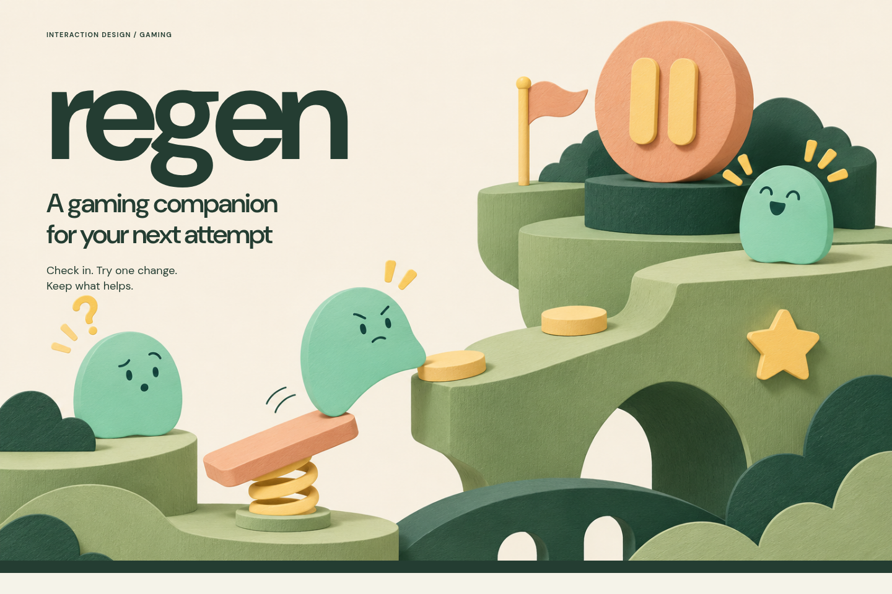

# Regen

[Open the visual case study](index.html).

A gaming story with product screens, Nori’s expression library, the player flow and an interactive CMA example. Short titles and descriptions lead the presentation. Supporting notes sit separately.

[Research and decisions](CASE-STUDY.md) · [Project context](PROJECT-CONTEXT.md) · [Feasibility](FEASIBILITY.md) · [Visual PDF](Regen-case-study.pdf)

Keep this folder and `assets/` together. Open `index.html` locally, or serve the folder with a local web server. The example runs in your browser without a camera, account or backend.

The native app is on `topic/checkpoint-case-study-20261118`. No new OTA is published. Screens use scripted demonstration inputs; the five persona scenarios are fictional. The papercraft world is generated brand artwork; the UI and Nori are native vectors.

For a single offline file, run `python export_standalone.py`. It creates `Regen.html` with embedded artwork, fonts, screens and interaction code.
